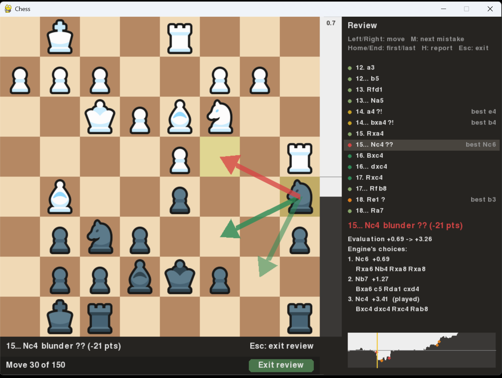

# chess-app

A chess engine, bots, graphical interface and game-review tools, written from scratch in Python.

The rules, the search, the evaluation, the Stockfish-based game review and the tactical theme classifier all live in this repository. The core uses only the standard library; `pygame-ce` (graphical interface) and `numpy` / `torch` (deep learning) are optional.



## Features

- **Rules**: legal move generation with castling, en passant and promotion, SAN / UCI / PGN, and draw detection (stalemate, threefold repetition, fifty-move rule, insufficient material). `tools.perft_bench` checks and benchmarks the move generator.
- **Bots**: `random`, `greedy` and `minimax`. The minimax bot uses alpha-beta with a transposition table (Zobrist hashing), iterative deepening, null-move pruning, late move reductions, check extensions, a check-aware quiescence search and a small opening book.
- **Evaluation**: material, piece-square tables blended between middlegame and endgame, passed / doubled / isolated pawns, bishop pair, king pawn shield, and a mop-up term for won endgames.
- **Interfaces**: a terminal interface and a Pygame interface (click to move, legal-move hints, promotion picker, the board flips when you play Black).
- **Game review**: inside the graphical interface or as a standalone HTML report. Every move is judged against Stockfish, with the engine's best moves, an evaluation bar and an evaluation curve.
- **Tactical themes**: a small convolutional network, trained locally on the Lichess puzzle database, suggests themes (fork, pin, skewer...) for the critical moments of a game. Forced mates always come from Stockfish, never from the network.
- **Measurement tools**: bot-vs-bot matches, a rating estimate against Stockfish at limited strength, blunder analysis, a tactical test suite and profiling.

## Installation

Python 3.12 or newer and [uv](https://docs.astral.sh/uv/) are required.

```bash
git clone https://github.com/bamont/chess-app.git
cd chess-app
uv sync --extra gui
```

For the deep-learning tools (training and running the theme classifier), add the `dl` extra:

```bash
uv sync --extra gui --extra dl
```

`uv sync` is exact: it removes the extras you do not list, so repeat every extra you need each time. On Windows ARM64, `torch` is installed from the PyTorch CPU index (see `pyproject.toml`).

[Stockfish](https://stockfishchess.org/download/) is only needed for the review, the rating and the analysis tools. Download it separately and note the path of the executable.

## Playing

```bash
uv run python main.py --bot minimax:3                      # terminal, against a bot
uv run python main.py --gui --bot minimax:3 --color black  # graphical interface
uv run python main.py --gui                                # two humans on one board
```

In the graphical interface, click a piece, then a destination. `N` starts a new game.

### Bot specifications

| Specification | Meaning |
|---|---|
| `random` | a random legal move |
| `greedy` | a simple one-move bot |
| `minimax[:option...]` | alpha-beta search, configured by the options below |

Options of `minimax`, separated by colons (for example `minimax:4`, `minimax:3:positional`, `minimax:time=2`):

| Option | Effect |
|---|---|
| `N` | search depth (default 2; limited to 64 when `time=` or `nodes=` is given) |
| `material`, `positional`, `advanced`, `noshield` | evaluation function (default `advanced`; `noshield` is `advanced` without the king shield) |
| `time=SECONDS`, `nodes=N` | stop the iterative deepening on a time or node budget |
| `nobook`, `noquiescence`, `quiescence=N`, `norepetition`, `notranspositions`, `noiterative`, `nonullmove`, `nolmr`, `nocheckext` | switch a feature off or tune it, which is useful for ablation matches |

## Game review

### In the graphical interface

Start the interface with a Stockfish executable (and optionally the theme classifier):

```bash
uv run python main.py --gui --bot minimax:3 \
    --engine path/to/stockfish \
    --motifs models/motifs_cal.npz
```

Play a few moves, then press `A` or click **Analyse**. The analysis runs in the background; when it finishes, the window switches to the review mode.

| Key / click | Action |
|---|---|
| Left / Right, Up / Down | previous / next move |
| Home / End | first / last move |
| `M` | jump to the next mistake |
| click on the move list or on the curve | jump to that move |
| `H` | open the HTML report in the browser |
| `Esc`, or the **Exit review** button | go back to the game (`R` reopens the review) |

The board shows the position before the move under review. The arrow of the move you played is coloured by its quality (green: best, blue: excellent or good, yellow: inaccuracy, orange: mistake, red: blunder), and the engine's best moves are drawn in green. The side panel lists every move, the engine's choices with their scores and lines, and an evaluation curve of the whole game. Scores are given from White's point of view.

Options: `--analysis-depth` (default 12) and `--analysis-lines`, the number of best moves shown for each position (default 3). Reports are saved in `reviews/`.

### As an HTML report

```bash
uv run chess-review games.pgn --engine path/to/stockfish --game 1 --depth 14